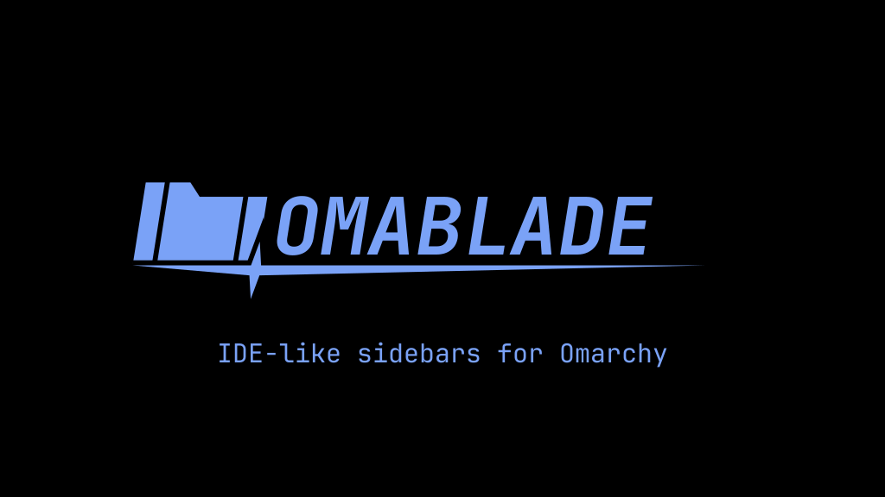

<p align="center"></p>

<p align="center"><strong>IDE-like sidebars for Omarchy: files, Git status, notes and your coding agents, one keystroke away.</strong></p>

<p align="center">
  
  
  
  
  <a href="LICENSE"></a>
  
</p>

<p align="center"></p>

> [!WARNING]
> **Disclaimer.** Omablade is an unofficial community project. It is not made,
> endorsed or supported by Omarchy, Basecamp or 37signals. It is a fork of
> [FileBlade](https://github.com/data-goblin/fileblade) by Kurt Buhler and is
> not affiliated with or supported by its original author. It has no published
> release yet and may change without notice. It moves, renames and deletes files
> when you ask it to, so keep backups. It is provided "as is", without warranty
> of any kind; see the [license](LICENSE).

**Omablade** gives you IDE-like sidebars in Omarchy:

- View, search and manage files, their properties and their contents
- See Git status and other information at a glance
- Drag files and hold Space for a quick-action wheel
- Keyboard- or mouse-first, quick to open and quick to put away
- Extend it with your own panes and actions

The [feature guides](features/index.md) cover each part in detail.

## What it is

Omablade is a native Omarchy application with left and right edge blades. A
blade can stay docked as a layer surface or become an ordinary tiled Hyprland
window. Each blade holds movable, resizable, tabbed module slots.

- Files, Properties, Notes, Branches, Skills, Memory, Hooks and MCP are built in
- The file-tree selection is shared with other modules and with your coding agents
- Search: zoxide-like quick nav, fzf-like deep search, filters such as `type:`, and regex
- File management: colors, undo/redo, cut/copy/paste, recents, home and Trash
- Blades look like your Hyprland windows (rounding, borders, opacity, gaps)
  and follow your Hyprland settings live
- The `omablade` CLI exposes the same workflows to scripts and agents
- Write your own panel with `omablade module new NAME --add right`, see edits
  with `omablade module reload`, and install extensions with
  `omablade extension install`

Extensions load from Omablade's native extension directory; see
[EXTENSIONS.md](EXTENSIONS.md).

## Installation

Omablade installs like any other Omarchy plugin. You need an up-to-date Omarchy
(4.0.2 or later) with Quickshell 0.3.1+, Qt 6.11.2+ and the packages in
[the runtime contract](packaging/runtime.json), on x86-64.

```bash
omarchy plugin add https://github.com/MASH2RAFI/omablade.git --enable
```

Omarchy clones it into `~/.config/omarchy/plugins/mash2rafi.omablade/`, checks
the manifest and turns it on; its bar widget opens a pane. Omarchy never runs
plugin code while installing, so two optional steps are yours to do:

```bash
# put the omablade command on your PATH
ln -s ~/.config/omarchy/plugins/mash2rafi.omablade/omablade ~/.local/bin/omablade

# Super+B / Super+Shift+B for the left and right blade, and blade-aware focus keys:
# paste the plugin's examples/omablade-bindings.lua into ~/.config/hypr/bindings.lua
```

Update or remove it the same way as other plugins:

```bash
omarchy plugin update mash2rafi.omablade
omarchy plugin remove mash2rafi.omablade
```

If you used the original FileBlade plugin, disable it first
(`omarchy plugin disable data-goblin.fileblade`) and remove its bindings; both
claim the same keys.

### Native app and from source

Omablade also runs as its own native app, outside the Omarchy shell. Build the
backend (rustup with the toolchain pinned in `rust-toolchain.toml`) and run the
checkout:

```bash
git clone https://github.com/MASH2RAFI/omablade
cd omablade
cargo build --release --locked
OMABLADE_BINARY="$PWD/target/release/omablade" ./omablade --version
```

The native app's desktop roles start disabled; enable the ones you want in
Settings → Desktop integration, or from the CLI:

```bash
omablade native roles enable --role bindings
omablade native roles enable --role autostart
```

Hold `Super` and drag with the right mouse button over a docked blade to resize
it. To remove the native app, reverse its desktop roles and stop it first:

```bash
omablade native roles disable --all
omablade native drain --timeout-ms 30000
```

[CONTRIBUTING.md](CONTRIBUTING.md) covers tests and rebuilding the bundled
backend.

## How it changes your system

- **Keybindings:** added only when you paste the example bindings (plugin) or
  enable the bindings role (native app). They open,
  focus, dock and resize blades and fall back to normal Hyprland behaviour when
  no blade has focus.
- **Windows:** docked blades reserve their strip of the screen, so tiled windows
  make room. While a blade has focus, other windows' active border is dimmed.
- **Trash:** trashed files go to `~/.local/share/Trash`. The first run asks
  whether Trash should be emptied automatically; Never is the initial choice.
  Agent resources managed from panes can be disabled into
  `~/.local/share/omablade/bin/` instead of trashed.
- **History:** recorded operations go to `~/.local/state/omarchy/omablade/audit.jsonl`;
  [undo/redo](features/operations/undo-redo.md) reverses eligible operations.
- **Settings:** layout and settings live in `~/.config/omarchy/omablade/`.

## More

- [ARCHITECTURE.md](ARCHITECTURE.md): how it is built
- [SECURITY.md](SECURITY.md): trust boundaries
- [CONTRIBUTING.md](CONTRIBUTING.md): tests and workflow
- [EXTENSIONS.md](EXTENSIONS.md): writing extensions

## License

[MIT](LICENSE). The license file lists every copyright holder.
